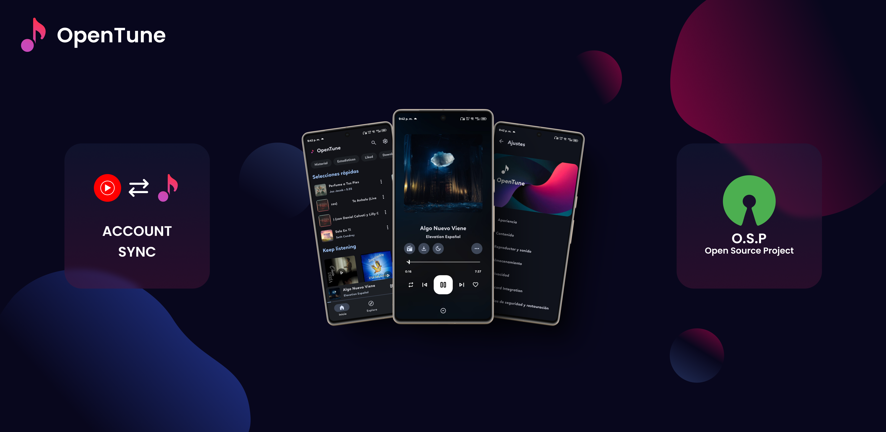

# Spotitube

<div align="center">
  
  
  ### Advanced YouTube Music Client with Material Design 3 for Android
  
  [](https://github.com/armory31/armoryProyect/releases)
  [](https://github.com/armory31/armoryProyect/blob/main/LICENSE)
  [](https://www.android.com)
  [](https://github.com/armory31/armoryProyect/stargazers)
  [](https://github.com/armory31/armoryProyect/network/members)
</div>

---

## Table of Contents

- [Overview](#overview)
- [Technology Stack](#technology-stack)
- [Key Features](#key-features)
- [Installation](#installation)
- [Building from Source](#building-from-source)
- [Contributing](#contributing)
- [License](#license)

---

## Overview

**Spotitube** is an open-source YouTube Music client specifically designed for Android devices. It delivers a superior user experience with a modern interface implementing Material Design 3, offering advanced functionalities to explore, play, and manage musical content without the limitations of the official application.

### Key Benefits

- **Ad-free Experience**: Enjoy uninterrupted music streaming
- **Enhanced Performance**: Optimized for smooth playback and navigation
- **Privacy-focused**: No data collection or tracking
- **Customizable Interface**: Personalize your music experience
- **Offline Capabilities**: Download and play music without internet connection

> **Note**: Spotitube is an independent project and is not affiliated, sponsored, or endorsed by YouTube or Google.

---

## Building from Source

### Environment Setup

```bash
# Clone the repository
git clone https://github.com/armory31/armoryProyect.git

# Navigate to project directory
cd armoryProyect
```

### Build Commands

```bash
# Build release version
./gradlew assembleRelease

# Build debug version
./gradlew assembleDebug
```

---

## Contributing

Please review our [Contributing Guidelines](CONTRIBUTING.md) and [Code of Conduct](CODE_OF_CONDUCT.md).

---

## License

**Copyright © 2025 Armory31**

This program is free software: you can redistribute it and/or modify it under the terms of the GNU General Public License as published by the Free Software Foundation, either version 3 of the License, or (at your option) any later version.

<div align="center">
  <p>Developed by <a href="https://github.com/armory31">Armory31</a></p>
</div>
