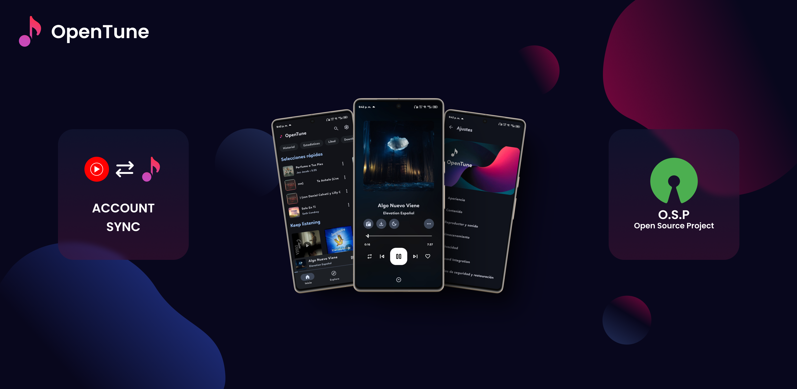

# Spotitube

<div >
  
  
  ### Cliente Avanzado de YouTube Music con Material Design 3 para Android
  
  [](https://github.com/armory31/armoryProyect/releases)
  [](https://github.com/armory31/armoryProyect/blob/main/LICENSE)
  [](https://www.android.com)
  [](https://github.com/armory31/armoryProyect/stargazers)
  [](https://github.com/armory31/armoryProyect/network/members)
</div>

[](README.en.md)

---

## Tabla de Contenido

- [Visión General](#visión-general)
- [Stack Tecnológico](#stack-tecnológico)
- [Características Principales](#características-principales)
- [Instalación](#instalación)
- [Compilación desde Código Fuente](#compilación-desde-código-fuente)
- [Contribuciones](#contribuciones)
- [Licencia](#licencia)

---

## Visión General

**Spotitube** es un cliente de YouTube Music de código abierto diseñado para dispositivos Android. Ofrece una experiencia de usuario superior con una interfaz moderna que implementa Material Design 3, proporcionando funcionalidades avanzadas para explorar, reproducir y gestionar contenido musical sin las limitaciones de la aplicación oficial.

### Beneficios Clave

- **Experiencia sin Anuncios**: Disfruta de música sin interrupciones publicitarias
- **Rendimiento Mejorado**: Optimizado para reproducción y navegación fluida
- **Enfoque en la Privacidad**: Sin recolección de datos ni seguimiento
- **Interfaz Personalizable**: Personaliza tu experiencia musical
- **Capacidades Offline**: Descarga y reproduce música sin conexión a internet

> **Nota**: Spotitube es un proyecto independiente y no está afiliado, patrocinado ni respaldado por YouTube o Google.

---

## Stack Tecnológico

<div >
  
|                                                                Frontend                                                                 |                                                      Backend                                                      |                                                   Herramientas de Desarrollo                                                   |
|:---------------------------------------------------------------------------------------------------------------------------------------:|:-----------------------------------------------------------------------------------------------------------------:|:------------------------------------------------------------------------------------------------------------------------------:|
|                                    |              |  |
|        |  |                           |
|  |                                                                                                                   |                                    |

</div>

---

## Características Principales

### Funcionalidad Principal
<table>
<tr>
<th >Característica</th>
<th >Descripción</th>
</tr>
<tr>
<td><strong>🎵 Reproducción sin Anuncios</strong></td>
<td>Disfruta de música sin interrupciones publicitarias</td>
</tr>
<tr>
<td><strong>🔄 Reproducción en Segundo Plano</strong></td>
<td>Continúa escuchando mientras usas otras aplicaciones</td>
</tr>
<tr>
<td><strong>🔍 Búsqueda Avanzada</strong></td>
<td>Encuentra rápidamente canciones, vídeos, álbumes y listas de reproducción</td>
</tr>
<tr>
<td><strong>👤 Integración de Cuenta</strong></td>
<td>Inicia sesión para sincronizar preferencias y colecciones</td>
</tr>
<tr>
<td><strong>📚 Gestión de Biblioteca</strong></td>
<td>Organiza y administra completamente tu colección musical</td>
</tr>
<tr>
<td><strong>📱 Modo Offline</strong></td>
<td>Descarga contenido para escuchar sin conexión</td>
</tr>
</table>

### Mejoras de Audio
<table>
<tr>
<th >Característica</th>
<th >Descripción</th>
</tr>
<tr>
<td><strong>🎤 Letras Sincronizadas</strong></td>
<td>Visualiza letras de canciones perfectamente sincronizadas</td>
</tr>
<tr>
<td><strong>⚡ Omisión Inteligente de Silencios</strong></td>
<td>Omite automáticamente segmentos sin audio</td>
</tr>
<tr>
<td><strong>🔊 Normalización de Volumen</strong></td>
<td>Equilibra los niveles de sonido entre diferentes pistas</td>
</tr>
<tr>
<td><strong>🎛️ Control de Tempo y Tono</strong></td>
<td>Ajusta la velocidad y el tono de reproducción según preferencias</td>
</tr>
</table>

### Personalización e Integración
<table>
<tr>
<th >Característica</th>
<th >Descripción</th>
</tr>
<tr>
<td><strong>🎨 Temas Dinámicos</strong></td>
<td>La interfaz se adapta a los colores de las portadas de álbumes</td>
</tr>
<tr>
<td><strong>🌐 Soporte Multiidioma</strong></td>
<td>Disponible en numerosos idiomas para usuarios globales</td>
</tr>
<tr>
<td><strong>🚗 Compatible con Android Auto</strong></td>
<td>Integración con sistemas de infoentretenimiento vehicular</td>
</tr>
<tr>
<td><strong>🎯 Material Design 3</strong></td>
<td>Diseño alineado con las últimas directrices de diseño de Google</td>
</tr>
<tr>
<td><strong>🖼️ Exportación de Portadas</strong></td>
<td>Guarda imágenes de álbumes en alta resolución</td>
</tr>
</table>

---

## Instalación

### Requisitos del Sistema

| Componente                | Requisito Mínimo                     |
|:--------------------------|:-------------------------------------|
| Sistema Operativo         | Android 6.0 (Marshmallow) o superior |
| Espacio de Almacenamiento | 10 MB disponibles                    |
| Red                       | Conexión a Internet para streaming   |
| RAM                       | 2 GB recomendados                    |

### Métodos de Instalación

#### Opción 1: Releases de GitHub (Recomendado)

1. Navega a la sección de [Releases](https://github.com/armory31/armoryProyect/releases) en GitHub
2. Descarga el archivo APK de la última versión estable
3. Habilita "Instalar desde fuentes desconocidas" en la configuración de seguridad de tu dispositivo
4. Abre el archivo APK descargado para completar la instalación

---

## Compilación desde Código Fuente

### Requisitos Previos

<table>
<tr>
<th>Herramienta</th>
<th>Versión Recomendada</th>
<th>Propósito</th>
</tr>
<tr>
<td>Gradle</td>
<td>7.5 o superior</td>
<td>Automatización de construcción</td>
</tr>
<tr>
<td>Kotlin</td>
<td>1.7 o superior</td>
<td>Lenguaje de programación</td>
</tr>
<tr>
<td>Android Studio</td>
<td>2022.1 o superior</td>
<td>IDE y entorno de desarrollo</td>
</tr>
<tr>
<td>JDK</td>
<td>11 o superior</td>
<td>Ámbito de ejecución Java</td>
</tr>
<tr>
<td>Android SDK</td>
<td>API nivel 33 (Android 13)</td>
<td>Herramientas de desarrollo Android</td>
</tr>
</table>

### Configuración del Entorno

```bash
# Clonar el repositorio
git clone https://github.com/armory31/armoryProyect.git

# Navegar al directorio del proyecto
cd armoryProyect
```

### Métodos de Compilación

#### Compilación con Android Studio

1. Abre Android Studio
2. Selecciona "Abrir un proyecto existente de Android Studio"
3. Navega y selecciona el directorio del proyecto
4. Espera a que se complete la sincronización del proyecto y la indexación
5. Selecciona Construir → Construir Bundle(s) / APK(s) → Construir APK(s)

#### Compilación por Línea de Comandos

```bash
# Construir versión de producción
./gradlew assembleRelease

# Construir versión de depuración
./gradlew assembleDebug
```

---

## Contribuciones

### Código de Conducta

Todos los participantes en este proyecto deben adherirse a nuestro código de conducta que promueve un entorno inclusivo, respetuoso y constructivo. Por favor, revisa el [Código de Conducta completo](https://github.com/armory31/armoryProyect/blob/master/CODE_OF_CONDUCT.md) antes de contribuir.

### Flujo de Trabajo de Desarrollo

1. **Revisión de Issues**: Verifica [issues abiertas](https://github.com/armory31/armoryProyect/issues) o crea una nueva
2. **Fork del Repositorio**: Crea un fork personal del repositorio
3. **Rama de Característica**: Crea una rama para tu característica
4. **Pull Request**: Abre un PR detallando los cambios

---

## Licencia

**Copyright © 2025 Armory31**

Este programa es software libre: puedes redistribuirlo y/o modificarlo bajo los términos de la Licencia Pública General GNU publicada por la Free Software Foundation, ya sea la versión 3 de la Licencia, o (a tu elección) cualquier versión posterior.

Este programa se distribuye con la esperanza de que sea útil, pero **SIN NINGUNA GARANTÍA**; ni siquiera la garantía implícita de COMERCIABILIDAD o IDONEIDAD PARA UN PROPÓSITO PARTICULAR. Consulta la [Licencia Pública General GNU](https://github.com/armory31/armoryProyect/blob/main/LICENSE) para más detalles.

<div >
  
[](https://www.gnu.org/licenses/gpl-3.0)

</div>

---

<div >
  <p>Desarrollado por <a href="https://github.com/armory31">Armory31</a></p>
</div>
